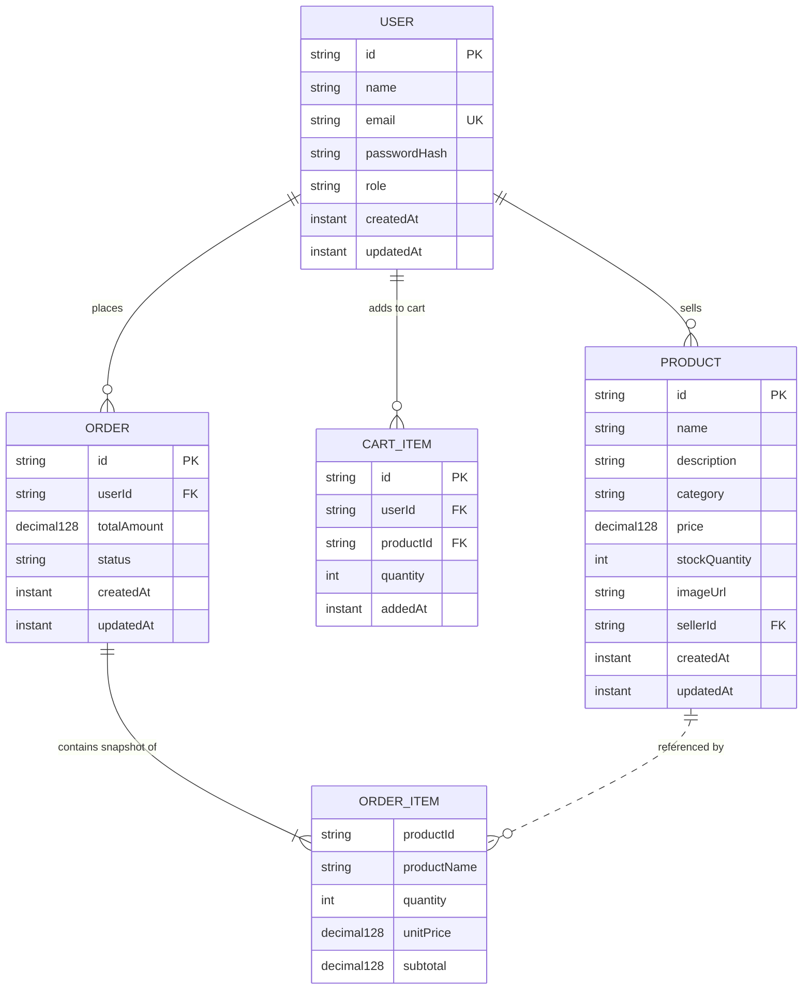

# Scalable E-Commerce System

A production-grade, highly scalable distributed E-Commerce platform built using modern cloud-native architectures, Java 21, Spring Boot 3, MongoDB, Redis, Docker Compose, Postman, and distributed system design patterns.

---

## Current Status: All 20 Phases Completed

* **Phases 1–5**: Infrastructure, Data Models, JWT Security, API Standards — Completed
* **Phases 6–10**: Catalog, Redis Cache-Aside, Cart, Orders, Snowflake ID Generator — Completed
* **Phases 11–15**: Distributed Rate Limiting, Key-Value Store, Consistent Hashing, Sharding Router, Elastic Rebalance — Completed
* **Phase 16: URL Shortener Service** — Base62 Snowflake encoding, MongoDB persistence, HTTP 302 redirection, expiration, click analytics — Completed
* **Phase 17: Web Crawler Service** — Controlled demo crawler, SSRF validator, URL normalization & deduplication, Jsoup HTML parser, async thread pool — Completed
* **Phase 18: Autocomplete & Search Suggestions** — In-memory prefix Trie, multi-token indexing, Redis caching, stock-aware ranking, highlight formatting — Completed
* **Phase 19: Competitor Price Monitoring** — Authorized source allowlists, HTML price parsing, historical observations, price comparisons, no automatic price changes — Completed
* **Phase 20: Performance, Scalability & Failure Evaluation** — Empirical benchmark suite, measured throughput/latencies, failure recovery, formal evaluation report (`docs/performance-and-failure-evaluation.md`) — Completed

---

## 20-Phase Implementation Roadmap

1. [x] **Phase 1**: Project Structure and Backend Initialization
2. [x] **Phase 2**: Database and Cache Infrastructure Setup
3. [x] **Phase 3**: Database Design and Common Models
4. [x] **Phase 4**: API Standards and Postman Setup
5. [x] **Phase 5**: User Authentication & JWT Service
6. [x] **Phase 6**: Product Catalog & Inventory Service
7. [x] **Phase 7**: High-Performance Product Caching (Redis Cache-Aside)
8. [x] **Phase 8**: Shopping Cart Service & Distributed Session Store
9. [x] **Phase 9**: Order Processing Pipeline & Unique ID Integration
10. [x] **Phase 10**: Distributed Unique ID Generator (Snowflake Algorithm)
11. [x] **Phase 11**: Distributed Rate Limiting (Sliding Window via Redis Lua)
12. [x] **Phase 12**: In-Memory Key-Value Storage Engine with Dual Expiration
13. [x] **Phase 13**: Consistent Hash Ring with Virtual Nodes (Ketama MD5)
14. [x] **Phase 14**: Logical Database Sharding & Shard Router
15. [x] **Phase 15**: Elastic Shard Rebalance Simulation & Key Migration
16. [x] **Phase 16**: Distributed URL Shortener Service (Base62 + Snowflake)
17. [x] **Phase 17**: Controlled Web Crawler with SSRF Defense & Jsoup Extraction
18. [x] **Phase 18**: High-Throughput Search Suggestions & Prefix Autocomplete Trie
19. [x] **Phase 19**: Responsible Competitor Price Monitoring & History Comparison
20. [x] **Phase 20**: Empirical Performance, Scalability & Failure Evaluation Report

---

## Technology Stack

* **Programming Language**: Java 21 (LTS - Eclipse Temurin)
* **Backend Framework**: Spring Boot 3.3.5
* **Security & Tokens**: Spring Security 6 (`spring-boot-starter-security`), JJWT 0.12.6 (`jjwt-api`, `jjwt-impl`, `jjwt-jackson`)
* **Password Hashing**: BCrypt (`BCryptPasswordEncoder`)
* **Build Tool**: Apache Maven (3.9+)
* **Primary Database**: MongoDB 7.0 (Document Store)
* **Distributed Cache**: Redis 7.4 Alpine (In-Memory Key-Value)
* **Validation**: Jakarta Bean Validation (`spring-boot-starter-validation` / Hibernate Validator)
* **API Testing & Specification**: Postman Collection v2.1.0 & Environments
* **Containerization & Orchestration**: Docker & Docker Compose
* **Testing Suite**: JUnit 5, Spring Boot Test, Spring Security Test, Mockito, MockMvc

---

## Prerequisites

Before running the application or its containers, ensure the following tools are installed:

1. **Java Development Kit (JDK) 21**:
   ```powershell
   java -version
   ```
2. **Apache Maven 3.9+**:
   ```powershell
   mvn -version
   ```
3. **Docker Desktop & Docker Compose**:
   ```powershell
   docker --version
   docker compose version
   ```
4. **Postman (v10+)**: For API testing and request execution.

---

## Repository Structure

```text
ECommerce-System/
├── backend/
│   ├── pom.xml                                      # Maven dependencies (Security, JJWT, Mongo, Redis, Web)
│   ├── Dockerfile                                   # Multi-stage Java 21 container specification
│   ├── .dockerignore                                # Build context exclusions for Docker
│   └── src/
│       ├── main/
│       │   ├── java/
│       │   │   └── com/
│       │   │       └── ecommerce/
│       │   │           ├── EcommerceApplication.java # Spring Boot entry point
│       │   │           ├── controller/
│       │   │           │   └── AuthController.java          # REST controller for register, login, profile (/me)
│       │   │           ├── dto/
│       │   │           │   ├── ApiResponse.java             # Generic success response wrapper
│       │   │           │   ├── ApiErrorResponse.java        # Structured error response DTO
│       │   │           │   ├── ValidationError.java         # Field-level validation error DTO
│       │   │           │   ├── RegisterRequest.java         # Registration request payload record
│       │   │           │   ├── LoginRequest.java            # Login request payload record
│       │   │           │   ├── UserResponse.java            # Safe user profile DTO (no password)
│       │   │           │   └── AuthResponse.java            # JWT auth token response DTO
│       │   │           ├── exception/
│       │   │           │   ├── ApiException.java            # Base unchecked API exception
│       │   │           │   ├── BadRequestException.java     # 400 Bad Request exception
│       │   │           │   ├── ResourceNotFoundException.java # 404 Not Found exception
│       │   │           │   ├── ConflictException.java       # 409 Conflict exception
│       │   │           │   └── GlobalExceptionHandler.java  # Centralized error handler
│       │   │           ├── health/
│       │   │           │   ├── HealthController.java        # REST controller for liveness & readiness
│       │   │           │   ├── HealthResponse.java          # Liveness DTO
│       │   │           │   ├── DependencyHealthResponse.java# Readiness DTO (MongoDB & Redis)
│       │   │           │   └── DependencyHealthService.java # Connectivity & ping health service
│       │   │           ├── model/
│       │   │           │   ├── User.java                    # User document model
│       │   │           │   ├── UserRole.java                # User role enum (CUSTOMER, SELLER, ADMIN)
│       │   │           │   ├── Product.java                 # Catalog product document model
│       │   │           │   ├── CartItem.java                # Shopping cart item document model
│       │   │           │   ├── Order.java                   # Order document model
│       │   │           │   ├── OrderItem.java               # Embedded order line-item value object
│       │   │           │   └── OrderStatus.java             # Order lifecycle status enum
│       │   │           ├── repository/
│       │   │           │   ├── UserRepository.java          # Spring Data MongoDB repository for Users
│       │   │           │   ├── ProductRepository.java       # Spring Data MongoDB repository for Products
│       │   │           │   ├── CartItemRepository.java      # Spring Data MongoDB repository for CartItems
│       │   │           │   └── OrderRepository.java         # Spring Data MongoDB repository for Orders
│       │   │           ├── security/
│       │   │           │   ├── CustomAccessDeniedHandler.java # 403 Forbidden structured handler
│       │   │           │   ├── JwtAuthenticationEntryPoint.java # 401 Unauthorized structured handler
│       │   │           │   ├── JwtAuthenticationFilter.java # OncePerRequest Bearer token filter
│       │   │           │   ├── JwtTokenProvider.java        # JJWT 0.12.x token generator and parser
│       │   │           │   ├── SecurityConfig.java          # Stateless Spring Security filter chain
│       │   │           │   └── UserPrincipal.java           # Authenticated principal record
│       │   │           └── service/
│       │   │               └── AuthService.java             # Authentication & user management service
│       │   └── resources/
│       │       └── application.yml                  # Config properties, JWT settings & logging
│       └── test/
│           ├── java/
│           │   └── com/
│           │       └── ecommerce/
│           │           ├── EcommerceApplicationTests.java          # Context bootstrap test
│           │           ├── controller/
│           │           │   └── AuthControllerSecurityTest.java     # Auth endpoints and security filter tests
│           │           ├── dto/
│           │           │   └── ApiResponseTest.java                # DTO serialization and factory tests
│           │           ├── exception/
│           │           │   ├── GlobalExceptionHandlerTest.java     # Exception handler integration tests
│           │           │   └── TestApiController.java              # Test controller for triggering errors
│           │           ├── health/
│           │           │   ├── HealthControllerTest.java           # MockMvc endpoint tests
│           │           │   ├── DependencyHealthServiceTest.java    # Unit tests for ping logic
│           │           │   └── DependencyHealthIntegrationTest.java# Live container integration test
│           │           ├── model/
│           │           │   ├── UserModelTest.java                  # User validation and entity unit tests
│           │           │   ├── ProductModelTest.java               # Product validation and entity unit tests
│           │           │   ├── CartItemModelTest.java              # CartItem validation and entity unit tests
│           │           │   └── OrderModelTest.java                 # Order/OrderItem validation tests
│           │           ├── repository/
│           │           │   └── RepositoryUnitTest.java             # Repository mock behavior tests
│           │           ├── security/
│           │           │   └── JwtTokenProviderTest.java           # JWT generation, claim and validity tests
│           │           └── service/
│           │               └── AuthServiceTest.java                # Mockito unit tests for registration/login
│           └── resources/
│               └── application.yml                  # Test-scoped configuration
├── docker/
│   ├── docker-compose.yml                           # Compose orchestration (backend, mongodb, redis)
│   └── .env.example                                 # Template environment file (with JWT vars)
├── docs/
│   ├── api-standards.md                             # Comprehensive API design and status codes standard
│   └── authentication.md                            # Detailed Phase 5 authentication architecture & specs
├── testing/
│   ├── ecommerce-api.postman_collection.json        # Postman collection (Health + Authentication)
│   └── ecommerce-local.postman_environment.json     # Postman local environment variables
├── frontend/
├── .gitignore
└── README.md
```

---

## User Authentication & JWT Service (Phase 5)

Detailed security flows, token payload structures, and architectural justifications are documented in [`docs/authentication.md`](file:///c:/ECommerce-System/docs/authentication.md).

### 1. Key Security Features
* **Stateless Architecture**: Zero server-side session overhead (`SessionCreationPolicy.STATELESS`).
* **Cryptographic Password Hashing**: Passwords are never stored in plaintext. Spring Security's `BCryptPasswordEncoder` handles automatic salting (128-bit) and work factor stretching (10 rounds).
* **Role-Based Protection**: All self-registered users receive the `CUSTOMER` role. Privilege escalation by providing role attributes is strictly blocked.
* **Signed JWT Tokens**: Tokens are generated and validated using JJWT 0.12.6 with HMAC-SHA256 and a minimum 256-bit secret key.
* **Uniform Security Errors**: Custom `JwtAuthenticationEntryPoint` (401) and `CustomAccessDeniedHandler` (403) guarantee standard `ApiErrorResponse` JSON envelopes on all security violations.

### 2. Authentication Endpoints

| Method | Endpoint | Access | Description |
|---|---|---|---|
| `POST` | `/api/v1/auth/register` | Public | Registers a new customer account, validates email uniqueness, returns safe `UserResponse` (HTTP 201) |
| `POST` | `/api/v1/auth/login` | Public | Validates credentials, returns signed JWT access token in `AuthResponse` (HTTP 200) |
| `GET` | `/api/v1/auth/me` | Bearer Token | Authenticated route returning the caller's profile (HTTP 200) |

---

## API Standards and Error Handling (Phase 4)

Detailed conventions and guidelines are documented in [`docs/api-standards.md`](file:///c:/ECommerce-System/docs/api-standards.md).

### 1. Standard Response Envelope (`ApiResponse<T>`)
```json
{
  "success": true,
  "message": "Operation successful",
  "data": { ... },
  "timestamp": "2026-10-21T06:00:00.000Z"
}
```

### 2. Standard Error Response Format (`ApiErrorResponse`)
```json
{
  "timestamp": "2026-10-21T06:00:00.000Z",
  "status": 400,
  "error": "Bad Request",
  "message": "Request validation failed. Please check field errors.",
  "path": "/api/v1/resource",
  "validationErrors": [
    {
      "field": "name",
      "rejectedValue": "",
      "message": "Name is required"
    }
  ]
}
```

---

## Core Data Models and Database Design (Phase 3)

### Entity Overview & Relationships



---

## Health-Check Endpoints

### 1. Process Liveness: `GET /api/health`
Verifies that the Spring Boot application JVM process is running. This check is intentionally independent of external database availability.

* **URL**: `http://localhost:8080/api/health`
* **Status**: `200 OK`
* **Response**:
  ```json
  {
    "status": "UP",
    "application": "ecommerce-backend"
  }
  ```

### 2. Dependency Readiness: `GET /api/health/dependencies`
Verifies live connectivity to MongoDB (via lightweight `db.adminCommand('ping')`) and Redis (via `ping() -> PONG`).
* **All dependencies healthy**: Returns `HTTP 200 OK`.
* **Any dependency unavailable**: Returns `HTTP 503 SERVICE_UNAVAILABLE` with individual statuses (`"DOWN"`), without crashing the application.

---

## Member 4 Implementations: Phases 16–20

### 1. Phase 16: URL Shortener Service
* **Key Architecture**: Combines the 64-bit distributed Snowflake ID generator with alphanumeric Base62 encoding (`[0-9a-zA-Z]`), generating short 6–8 character codes.
* **Storage & Indexing**: Persistent MongoDB collection `short_urls` with unique index on `shortCode` and optional TTL index on `expiresAt`.
* **Redirection**: HTTP 302 redirect via `GET /r/{shortCode}` or `GET /{shortCode}`. Atomically increments `clickCount` via `MongoTemplate`.
* **Security & SSRF**: Validates HTTP/HTTPS schemes; never fetches or executes destination URLs; bounded retry policy for custom alias collisions.
* **Endpoints**:
  * `POST /api/v1/short-urls` — Create a shortened URL (supports custom aliases and TTL).
  * `GET /r/{shortCode}` — HTTP 302 Found redirect to original destination.
  * `GET /api/v1/short-urls/{shortCode}` — Inspect metadata, creation/expiration dates, and click counts.
  * `GET /api/v1/short-urls/my` — List authenticated user's shortened links (Requires JWT).

### 2. Phase 17: Demonstration Web Crawler Service
* **Key Architecture**: Controlled asynchronous demo web crawler for product analysis and market intelligence.
* **Security & SSRF Mitigation**: Proactive `SsrfValidator` resolves IP destinations using `InetAddress.getByName` and blocks loopback (`127.0.0.1`), link-local (`169.254.169.254`), and private RFC 1918 subnets. Re-validates destinations across redirect chains.
* **Deduplication & Parsing**: Canonical URL normalization (query param retention, port stripping) via SHA-256 fingerprint deduplication. Robust HTML parsing via Jsoup.
* **Configurable Limits**: Max depth (default 3), max pages (default 50), timeout (5,000 ms), max response size (2 MB), allowed domains filter.
* **Endpoints**:
  * `POST /api/v1/crawler/jobs` — Submit a crawl job with seeds and domain allowlists.
  * `GET /api/v1/crawler/jobs/{jobId}` — Inspect real-time status, pages processed, and error counters.
  * `GET /api/v1/crawler/jobs/{jobId}/results` — Retrieve extracted page titles, text summaries, status codes, and outbound links.
  * `POST /api/v1/crawler/jobs/{jobId}/cancel` — Gracefully terminate a running crawl job.

### 3. Phase 18: Autocomplete & Search Suggestions
* **Key Architecture**: Concurrency-safe prefix Trie (`AutocompleteTrie`) indexing in-stock product names and multi-word title tokens.
* **Performance Optimization**: Bounded candidate collection ($3 \times \text{limit}$) prevents memory bloat and delivers sub-millisecond suggestions (**31,916 ops/sec, p50: 29.4 μs**).
* **Caching**: Redis cache-aside key `autocomplete:prefix:{q}:{limit}` with 15-minute TTL. Automatically invalidated on product create, update, or delete.
* **Ranking & Formatting**: Prioritizes exact prefix matches, followed by word token matches, followed by alphabetical order. Generates `<b>` highlighted query prefixes.
* **Endpoint**:
  * `GET /api/v1/products/suggestions?q={prefix}&limit={limit}` — Retrieve real-time product search suggestions.

### 4. Phase 19: Competitor Price Monitoring
* **Key Architecture**: Responsible, lawful market price monitoring using strictly approved domain sources.
* **Safeguards**: Never scrapes arbitrary user URLs; enforces source domain allowlists; zero automatic modification of catalog product prices.
* **Price Parsing & Extraction**: Multi-currency extraction (`$`, `€`, `£`, `¥`, `INR`) with decimal normalization and strict rejection of negative/ambiguous values.
* **History & Comparison**: Maintains immutable historical observation documents. Computes price differences and percentage variances against local product prices.
* **Endpoints**:
  * `POST /api/v1/competitors/sources` — Register approved competitor domains and extraction strategies.
  * `GET /api/v1/competitors/sources` — List approved sources.
  * `POST /api/v1/competitors/mappings` — Map a local product to a competitor product URL.
  * `POST /api/v1/competitors/mappings/{id}/refresh` — Trigger authorized price observation refresh.
  * `GET /api/v1/competitors/products/{id}/comparison` — Compare local price against latest competitor observations.
  * `GET /api/v1/competitors/mappings/{id}/history` — Retrieve historical price tracking observations.

### 5. Phase 20: Performance, Scalability & Failure Evaluation
* **Evaluation Suite**: `com.ecommerce.benchmark.SystemPerformanceAndFailureBenchmarkTest` executing reproducible empirical benchmarks.
* **Measured Throughput**:
  * Snowflake ID Generator: **3,537,794 ops/sec** (p50: 100 ns)
  * Consistent Hash Ring: **495,989 ops/sec** (p50: 700 ns)
  * In-Memory KV Store: **428,088 ops/sec** (p50: 400 ns)
  * Autocomplete Trie: **31,916 ops/sec** (p50: 29.4 μs)
* **Failure Scenarios**: Verified Redis rate limiter `FAIL_OPEN` graceful degradation, Snowflake 2ms backward clock drift sleep synchronization, and SSRF attack defenses.
* **Full Evaluation Report**: Detailed empirical findings in [`docs/performance-and-failure-evaluation.md`](file:///c:/ECommerce-System/docs/performance-and-failure-evaluation.md).

---

## Postman Collection & Automated API Tests

Importable Postman assets are maintained in `testing/`:
* Collection: [`testing/ecommerce-api.postman_collection.json`](file:///c:/ECommerce-System/testing/ecommerce-api.postman_collection.json)
* Environment: [`testing/ecommerce-local.postman_environment.json`](file:///c:/ECommerce-System/testing/ecommerce-local.postman_environment.json)

### Executing with Postman
1. Open Postman -> Click **Import** -> Select both JSON files from `testing/`.
2. Select **ECommerce Local Environment** in the environment dropdown.
3. Run the collection to verify the automated tests:
   * Process Liveness test (`200 OK`).
   * Dependency Readiness test (`200 OK` or `503 SERVICE UNAVAILABLE`).
   * **Register User**: Registers `jane.doe@example.com`, validates `201 Created` and absence of password hash.
   * **Login User**: Authenticates credentials, verifies `200 OK`, extracts `accessToken` into Postman collection and environment variables.
   * **Get Current User Profile**: Verifies Bearer token authentication against `GET /api/v1/auth/me`.
   * **Get Current User (Unauthenticated)**: Negative verification of `401 Unauthorized` without token.

---

## Running Automated Tests

From the `backend/` directory:

### Run Unit, Model, Security & Controller Tests
All unit and controller tests run independently without requiring Docker or active database servers:

```powershell
cd backend
mvn test
```

### Run Full Verification Build
```powershell
cd backend
mvn clean verify
```

### Run Live Integration Tests against Containers
When Docker Compose services are running, enable integration tests via the `RUN_INTEGRATION_TESTS` environment variable:

```powershell
cd backend
$env:RUN_INTEGRATION_TESTS="true"
mvn test -Dtest=DependencyHealthIntegrationTest
```

---

## Running the Application with Docker Compose

From the project root (`C:\ECommerce-System`):

1. **Start all services** (MongoDB, Redis, and Backend):
   ```powershell
   docker compose -f docker/docker-compose.yml up -d --build
   ```
2. **Inspect container status**:
   ```powershell
   docker compose -f docker/docker-compose.yml ps
   ```
3. **Inspect application logs**:
   ```powershell
   docker compose -f docker/docker-compose.yml logs -f backend
   ```
4. **Stop services** (preserves MongoDB data volume):
   ```powershell
   docker compose -f docker/docker-compose.yml down
   ```
