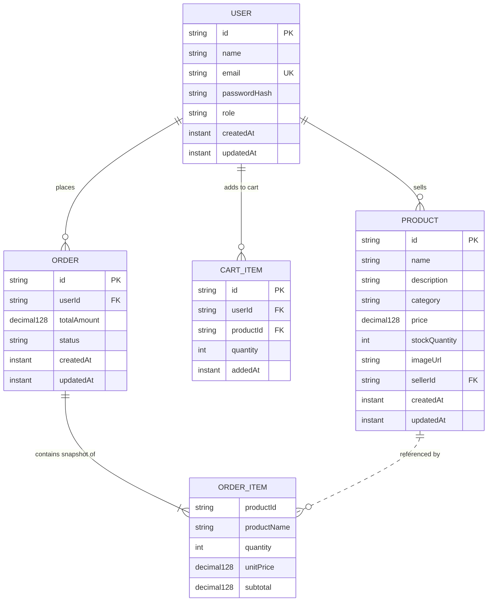

# Scalable E-Commerce System

A production-grade, highly scalable distributed E-Commerce platform built using modern cloud-native architectures, Java 21, Spring Boot 3, MongoDB, Redis, Docker Compose, Postman, and distributed system design patterns.

---

## Current Status: Phase 5 Completed

* **Phase 1: Project Structure and Backend Initialization** — Completed
* **Phase 2: Database and Cache Infrastructure Setup** — Completed
* **Phase 3: Database Design and Common Models** — Completed
* **Phase 4: API Standards and Postman Setup** — Completed
* **Phase 5: User Authentication & JWT Service** — Completed

Phase 5 establishes stateless user authentication, Spring Security configuration, BCrypt password hashing, signed HMAC-SHA256 JWT generation and validation, safe user DTOs (`UserResponse`, `AuthResponse`), centralized security exception handlers, automated test suites, and Postman integration.

> **Note on Future Phases**: Product catalog/inventory management, Redis cache-aside caching, shopping cart sessions, order processing, and payment orchestration are scheduled for subsequent phases (Phases 6 through 20).

---

## 20-Phase Implementation Roadmap

1. [x] **Phase 1**: Project Structure and Backend Initialization
2. [x] **Phase 2**: Database and Cache Infrastructure Setup
3. [x] **Phase 3**: Database Design and Common Models
4. [x] **Phase 4**: API Standards and Postman Setup
5. [x] **Phase 5**: User Authentication & JWT Service
6. [ ] **Phase 6**: Product Catalog & Inventory Service
7. [ ] **Phase 7**: High-Performance Product Caching (Redis Cache-Aside)
8. [ ] **Phase 8**: Shopping Cart Service & Distributed Session Store
9. [ ] **Phase 9**: Order Processing Pipeline & Saga Pattern
10. [ ] **Phase 10**: Distributed Unique ID Generator (Snowflake / UUIDv7)
11. [ ] **Phase 11**: Distributed Rate Limiting (Token Bucket / Sliding Window via Redis)
12. [ ] **Phase 12**: Search Service & Full-Text Search Engine
13. [ ] **Phase 13**: Real-Time Search Autocomplete (Trie / Redis Sorted Sets)
14. [ ] **Phase 14**: URL Shortener Service (Base62 Encoding & Bloom Filter)
15. [ ] **Phase 15**: Distributed Caching Invalidation & Cache Stampede Protection
16. [ ] **Phase 16**: Database Sharding & Partitioning Strategy
17. [ ] **Phase 17**: Distributed Lock Manager (Redlock Algorithm)
18. [ ] **Phase 18**: Asynchronous Messaging & Event-Driven Architecture (Kafka / RabbitMQ)
19. [ ] **Phase 19**: API Gateway, Routing & SSL Termination
20. [ ] **Phase 20**: Observability, Distributed Tracing & Centralized Logging

---

## Technology Stack

* **Programming Language**: Java 21 (LTS - Eclipse Temurin)
* **Backend Framework**: Spring Boot 3.3.5
* **Security & Tokens**: Spring Security 6 (`spring-boot-starter-security`), JJWT 0.12.6 (`jjwt-api`, `jjwt-impl`, `jjwt-jackson`)
* **Password Hashing**: BCrypt (`BCryptPasswordEncoder`)
* **Build Tool**: Apache Maven (3.9+)
* **Primary Database**: MongoDB 7.0 (Document Store)
* **Distributed Cache**: Redis 7.4 Alpine (In-Memory Key-Value)
* **Validation**: Jakarta Bean Validation (`spring-boot-starter-validation` / Hibernate Validator)
* **API Testing & Specification**: Postman Collection v2.1.0 & Environments
* **Containerization & Orchestration**: Docker & Docker Compose
* **Testing Suite**: JUnit 5, Spring Boot Test, Spring Security Test, Mockito, MockMvc

---

## Prerequisites

Before running the application or its containers, ensure the following tools are installed:

1. **Java Development Kit (JDK) 21**:
   ```powershell
   java -version
   ```
2. **Apache Maven 3.9+**:
   ```powershell
   mvn -version
   ```
3. **Docker Desktop & Docker Compose**:
   ```powershell
   docker --version
   docker compose version
   ```
4. **Postman (v10+)**: For API testing and request execution.

---

## Repository Structure

```text
ECommerce-System/
├── backend/
│   ├── pom.xml                                      # Maven dependencies (Security, JJWT, Mongo, Redis, Web)
│   ├── Dockerfile                                   # Multi-stage Java 21 container specification
│   ├── .dockerignore                                # Build context exclusions for Docker
│   └── src/
│       ├── main/
│       │   ├── java/
│       │   │   └── com/
│       │   │       └── ecommerce/
│       │   │           ├── EcommerceApplication.java # Spring Boot entry point
│       │   │           ├── controller/
│       │   │           │   └── AuthController.java          # REST controller for register, login, profile (/me)
│       │   │           ├── dto/
│       │   │           │   ├── ApiResponse.java             # Generic success response wrapper
│       │   │           │   ├── ApiErrorResponse.java        # Structured error response DTO
│       │   │           │   ├── ValidationError.java         # Field-level validation error DTO
│       │   │           │   ├── RegisterRequest.java         # Registration request payload record
│       │   │           │   ├── LoginRequest.java            # Login request payload record
│       │   │           │   ├── UserResponse.java            # Safe user profile DTO (no password)
│       │   │           │   └── AuthResponse.java            # JWT auth token response DTO
│       │   │           ├── exception/
│       │   │           │   ├── ApiException.java            # Base unchecked API exception
│       │   │           │   ├── BadRequestException.java     # 400 Bad Request exception
│       │   │           │   ├── ResourceNotFoundException.java # 404 Not Found exception
│       │   │           │   ├── ConflictException.java       # 409 Conflict exception
│       │   │           │   └── GlobalExceptionHandler.java  # Centralized error handler
│       │   │           ├── health/
│       │   │           │   ├── HealthController.java        # REST controller for liveness & readiness
│       │   │           │   ├── HealthResponse.java          # Liveness DTO
│       │   │           │   ├── DependencyHealthResponse.java# Readiness DTO (MongoDB & Redis)
│       │   │           │   └── DependencyHealthService.java # Connectivity & ping health service
│       │   │           ├── model/
│       │   │           │   ├── User.java                    # User document model
│       │   │           │   ├── UserRole.java                # User role enum (CUSTOMER, SELLER, ADMIN)
│       │   │           │   ├── Product.java                 # Catalog product document model
│       │   │           │   ├── CartItem.java                # Shopping cart item document model
│       │   │           │   ├── Order.java                   # Order document model
│       │   │           │   ├── OrderItem.java               # Embedded order line-item value object
│       │   │           │   └── OrderStatus.java             # Order lifecycle status enum
│       │   │           ├── repository/
│       │   │           │   ├── UserRepository.java          # Spring Data MongoDB repository for Users
│       │   │           │   ├── ProductRepository.java       # Spring Data MongoDB repository for Products
│       │   │           │   ├── CartItemRepository.java      # Spring Data MongoDB repository for CartItems
│       │   │           │   └── OrderRepository.java         # Spring Data MongoDB repository for Orders
│       │   │           ├── security/
│       │   │           │   ├── CustomAccessDeniedHandler.java # 403 Forbidden structured handler
│       │   │           │   ├── JwtAuthenticationEntryPoint.java # 401 Unauthorized structured handler
│       │   │           │   ├── JwtAuthenticationFilter.java # OncePerRequest Bearer token filter
│       │   │           │   ├── JwtTokenProvider.java        # JJWT 0.12.x token generator and parser
│       │   │           │   ├── SecurityConfig.java          # Stateless Spring Security filter chain
│       │   │           │   └── UserPrincipal.java           # Authenticated principal record
│       │   │           └── service/
│       │   │               └── AuthService.java             # Authentication & user management service
│       │   └── resources/
│       │       └── application.yml                  # Config properties, JWT settings & logging
│       └── test/
│           ├── java/
│           │   └── com/
│           │       └── ecommerce/
│           │           ├── EcommerceApplicationTests.java          # Context bootstrap test
│           │           ├── controller/
│           │           │   └── AuthControllerSecurityTest.java     # Auth endpoints and security filter tests
│           │           ├── dto/
│           │           │   └── ApiResponseTest.java                # DTO serialization and factory tests
│           │           ├── exception/
│           │           │   ├── GlobalExceptionHandlerTest.java     # Exception handler integration tests
│           │           │   └── TestApiController.java              # Test controller for triggering errors
│           │           ├── health/
│           │           │   ├── HealthControllerTest.java           # MockMvc endpoint tests
│           │           │   ├── DependencyHealthServiceTest.java    # Unit tests for ping logic
│           │           │   └── DependencyHealthIntegrationTest.java# Live container integration test
│           │           ├── model/
│           │           │   ├── UserModelTest.java                  # User validation and entity unit tests
│           │           │   ├── ProductModelTest.java               # Product validation and entity unit tests
│           │           │   ├── CartItemModelTest.java              # CartItem validation and entity unit tests
│           │           │   └── OrderModelTest.java                 # Order/OrderItem validation tests
│           │           ├── repository/
│           │           │   └── RepositoryUnitTest.java             # Repository mock behavior tests
│           │           ├── security/
│           │           │   └── JwtTokenProviderTest.java           # JWT generation, claim and validity tests
│           │           └── service/
│           │               └── AuthServiceTest.java                # Mockito unit tests for registration/login
│           └── resources/
│               └── application.yml                  # Test-scoped configuration
├── docker/
│   ├── docker-compose.yml                           # Compose orchestration (backend, mongodb, redis)
│   └── .env.example                                 # Template environment file (with JWT vars)
├── docs/
│   ├── api-standards.md                             # Comprehensive API design and status codes standard
│   └── authentication.md                            # Detailed Phase 5 authentication architecture & specs
├── testing/
│   ├── ecommerce-api.postman_collection.json        # Postman collection (Health + Authentication)
│   └── ecommerce-local.postman_environment.json     # Postman local environment variables
├── frontend/
├── .gitignore
└── README.md
```

---

## User Authentication & JWT Service (Phase 5)

Detailed security flows, token payload structures, and architectural justifications are documented in [`docs/authentication.md`](file:///c:/ECommerce-System/docs/authentication.md).

### 1. Key Security Features
* **Stateless Architecture**: Zero server-side session overhead (`SessionCreationPolicy.STATELESS`).
* **Cryptographic Password Hashing**: Passwords are never stored in plaintext. Spring Security's `BCryptPasswordEncoder` handles automatic salting (128-bit) and work factor stretching (10 rounds).
* **Role-Based Protection**: All self-registered users receive the `CUSTOMER` role. Privilege escalation by providing role attributes is strictly blocked.
* **Signed JWT Tokens**: Tokens are generated and validated using JJWT 0.12.6 with HMAC-SHA256 and a minimum 256-bit secret key.
* **Uniform Security Errors**: Custom `JwtAuthenticationEntryPoint` (401) and `CustomAccessDeniedHandler` (403) guarantee standard `ApiErrorResponse` JSON envelopes on all security violations.

### 2. Authentication Endpoints

| Method | Endpoint | Access | Description |
|---|---|---|---|
| `POST` | `/api/v1/auth/register` | Public | Registers a new customer account, validates email uniqueness, returns safe `UserResponse` (HTTP 201) |
| `POST` | `/api/v1/auth/login` | Public | Validates credentials, returns signed JWT access token in `AuthResponse` (HTTP 200) |
| `GET` | `/api/v1/auth/me` | Bearer Token | Authenticated route returning the caller's profile (HTTP 200) |

---

## API Standards and Error Handling (Phase 4)

Detailed conventions and guidelines are documented in [`docs/api-standards.md`](file:///c:/ECommerce-System/docs/api-standards.md).

### 1. Standard Response Envelope (`ApiResponse<T>`)
```json
{
  "success": true,
  "message": "Operation successful",
  "data": { ... },
  "timestamp": "2026-10-21T06:00:00.000Z"
}
```

### 2. Standard Error Response Format (`ApiErrorResponse`)
```json
{
  "timestamp": "2026-10-21T06:00:00.000Z",
  "status": 400,
  "error": "Bad Request",
  "message": "Request validation failed. Please check field errors.",
  "path": "/api/v1/resource",
  "validationErrors": [
    {
      "field": "name",
      "rejectedValue": "",
      "message": "Name is required"
    }
  ]
}
```

---

## Core Data Models and Database Design (Phase 3)

### Entity Overview & Relationships



---

## Health-Check Endpoints

### 1. Process Liveness: `GET /api/health`
Verifies that the Spring Boot application JVM process is running. This check is intentionally independent of external database availability.

* **URL**: `http://localhost:8080/api/health`
* **Status**: `200 OK`
* **Response**:
  ```json
  {
    "status": "UP",
    "application": "ecommerce-backend"
  }
  ```

### 2. Dependency Readiness: `GET /api/health/dependencies`
Verifies live connectivity to MongoDB (via lightweight `db.adminCommand('ping')`) and Redis (via `ping() -> PONG`).
* **All dependencies healthy**: Returns `HTTP 200 OK`.
* **Any dependency unavailable**: Returns `HTTP 503 SERVICE_UNAVAILABLE` with individual statuses (`"DOWN"`), without crashing the application.

---

## Postman Collection & Automated API Tests

Importable Postman assets are maintained in `testing/`:
* Collection: [`testing/ecommerce-api.postman_collection.json`](file:///c:/ECommerce-System/testing/ecommerce-api.postman_collection.json)
* Environment: [`testing/ecommerce-local.postman_environment.json`](file:///c:/ECommerce-System/testing/ecommerce-local.postman_environment.json)

### Executing with Postman
1. Open Postman -> Click **Import** -> Select both JSON files from `testing/`.
2. Select **ECommerce Local Environment** in the environment dropdown.
3. Run the collection to verify the automated tests:
   * Process Liveness test (`200 OK`).
   * Dependency Readiness test (`200 OK` or `503 SERVICE UNAVAILABLE`).
   * **Register User**: Registers `jane.doe@example.com`, validates `201 Created` and absence of password hash.
   * **Login User**: Authenticates credentials, verifies `200 OK`, extracts `accessToken` into Postman collection and environment variables.
   * **Get Current User Profile**: Verifies Bearer token authentication against `GET /api/v1/auth/me`.
   * **Get Current User (Unauthenticated)**: Negative verification of `401 Unauthorized` without token.

---

## Running Automated Tests

From the `backend/` directory:

### Run Unit, Model, Security & Controller Tests
All unit and controller tests run independently without requiring Docker or active database servers:

```powershell
cd backend
mvn test
```

### Run Full Verification Build
```powershell
cd backend
mvn clean verify
```

### Run Live Integration Tests against Containers
When Docker Compose services are running, enable integration tests via the `RUN_INTEGRATION_TESTS` environment variable:

```powershell
cd backend
$env:RUN_INTEGRATION_TESTS="true"
mvn test -Dtest=DependencyHealthIntegrationTest
```

---

## Running the Application with Docker Compose

From the project root (`C:\ECommerce-System`):

1. **Start all services** (MongoDB, Redis, and Backend):
   ```powershell
   docker compose -f docker/docker-compose.yml up -d --build
   ```
2. **Inspect container status**:
   ```powershell
   docker compose -f docker/docker-compose.yml ps
   ```
3. **Inspect application logs**:
   ```powershell
   docker compose -f docker/docker-compose.yml logs -f backend
   ```
4. **Stop services** (preserves MongoDB data volume):
   ```powershell
   docker compose -f docker/docker-compose.yml down
   ```
