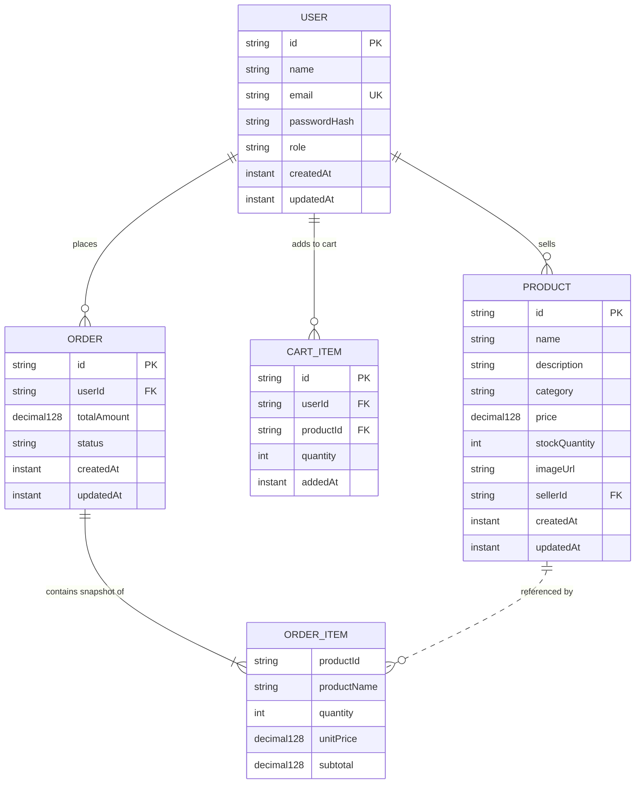

# Scalable E-Commerce System

A production-grade, highly scalable distributed E-Commerce platform built using modern cloud-native architectures, Java 21, Spring Boot 3, MongoDB, Redis, Docker Compose, Postman, and distributed system design patterns.

---

## Current Status: Phase 4 Completed

* **Phase 1: Project Structure and Backend Initialization** — Completed
* **Phase 2: Database and Cache Infrastructure Setup** — Completed
* **Phase 3: Database Design and Common Models** — Completed
* **Phase 4: API Standards and Postman Setup** — Completed

Phase 4 establishes uniform REST API design conventions, generic response wrappers (`ApiResponse<T>`), structured error formatting (`ApiErrorResponse`), field-level validation reporting, centralized exception handling (`GlobalExceptionHandler`), and importable Postman collections with automated test scripts.

> **Note on Future Phases**: User registration/login endpoints, JWT authentication, product CRUD/search APIs, shopping cart APIs, order placement, and Redis caching business logic are scheduled for subsequent phases (Phases 5 through 20).

---

## 20-Phase Implementation Roadmap

1. [x] **Phase 1**: Project Structure and Backend Initialization
2. [x] **Phase 2**: Database and Cache Infrastructure Setup
3. [x] **Phase 3**: Database Design and Common Models
4. [x] **Phase 4**: API Standards and Postman Setup
5. [ ] **Phase 5**: User Authentication & JWT Service
6. [ ] **Phase 6**: Product Catalog & Inventory Service
7. [ ] **Phase 7**: High-Performance Product Caching (Redis Cache-Aside)
8. [ ] **Phase 8**: Shopping Cart Service & Distributed Session Store
9. [ ] **Phase 9**: Order Processing Pipeline & Saga Pattern
10. [ ] **Phase 10**: Distributed Unique ID Generator (Snowflake / UUIDv7)
11. [ ] **Phase 11**: Distributed Rate Limiting (Token Bucket / Sliding Window via Redis)
12. [ ] **Phase 12**: Search Service & Full-Text Search Engine
13. [ ] **Phase 13**: Real-Time Search Autocomplete (Trie / Redis Sorted Sets)
14. [ ] **Phase 14**: URL Shortener Service (Base62 Encoding & Bloom Filter)
15. [ ] **Phase 15**: Distributed Caching Invalidation & Cache Stampede Protection
16. [ ] **Phase 16**: Database Sharding & Partitioning Strategy
17. [ ] **Phase 17**: Distributed Lock Manager (Redlock Algorithm)
18. [ ] **Phase 18**: Asynchronous Messaging & Event-Driven Architecture (Kafka / RabbitMQ)
19. [ ] **Phase 19**: API Gateway, Routing & SSL Termination
20. [ ] **Phase 20**: Observability, Distributed Tracing & Centralized Logging

---

## Technology Stack

* **Programming Language**: Java 21 (LTS - Eclipse Temurin)
* **Backend Framework**: Spring Boot 3.3.5
* **Build Tool**: Apache Maven (3.9+)
* **Primary Database**: MongoDB 7.0 (Document Store)
* **Distributed Cache**: Redis 7.4 Alpine (In-Memory Key-Value)
* **Validation**: Jakarta Bean Validation (`spring-boot-starter-validation` / Hibernate Validator)
* **API Testing & Specification**: Postman Collection v2.1.0 & Environments
* **Containerization & Orchestration**: Docker & Docker Compose
* **Testing Suite**: JUnit 5, Spring Boot Test, Mockito, MockMvc

---

## Prerequisites

Before running the application or its containers, ensure the following tools are installed:

1. **Java Development Kit (JDK) 21**:
   ```powershell
   java -version
   ```
2. **Apache Maven 3.9+**:
   ```powershell
   mvn -version
   ```
3. **Docker Desktop & Docker Compose**:
   ```powershell
   docker --version
   docker compose version
   ```
4. **Postman (v10+)**: For API testing and request execution.

---

## Repository Structure

```text
ECommerce-System/
├── backend/
│   ├── pom.xml                                      # Maven project configuration and dependencies
│   ├── Dockerfile                                   # Multi-stage Java 21 container specification
│   ├── .dockerignore                                # Build context exclusions for Docker
│   └── src/
│       ├── main/
│       │   ├── java/
│       │   │   └── com/
│       │   │       └── ecommerce/
│       │   │           ├── EcommerceApplication.java # Spring Boot entry point
│       │   │           ├── dto/
│       │   │           │   ├── ApiResponse.java             # Generic success response wrapper
│       │   │           │   ├── ApiErrorResponse.java        # Structured error response DTO
│       │   │           │   └── ValidationError.java         # Field-level validation error DTO
│       │   │           ├── exception/
│       │   │           │   ├── ApiException.java            # Base unchecked API exception
│       │   │           │   ├── BadRequestException.java     # 400 Bad Request exception
│       │   │           │   ├── ResourceNotFoundException.java # 404 Not Found exception
│       │   │           │   ├── ConflictException.java       # 409 Conflict exception
│       │   │           │   └── GlobalExceptionHandler.java  # @RestControllerAdvice centralized error handler
│       │   │           ├── health/
│       │   │           │   ├── HealthController.java        # REST controller for liveness & readiness
│       │   │           │   ├── HealthResponse.java          # Liveness DTO
│       │   │           │   ├── DependencyHealthResponse.java# Readiness DTO (MongoDB & Redis)
│       │   │           │   └── DependencyHealthService.java # Connectivity & ping health service
│       │   │           ├── model/
│       │   │           │   ├── User.java                    # User document model
│       │   │           │   ├── UserRole.java                # User role enum (CUSTOMER, SELLER, ADMIN)
│       │   │           │   ├── Product.java                 # Catalog product document model
│       │   │           │   ├── CartItem.java                # Shopping cart item document model
│       │   │           │   ├── Order.java                   # Order document model
│       │   │           │   ├── OrderItem.java               # Embedded order line-item value object
│       │   │           │   └── OrderStatus.java             # Order lifecycle status enum
│       │   │           └── repository/
│       │   │               ├── UserRepository.java          # Spring Data MongoDB repository for Users
│       │   │               ├── ProductRepository.java       # Spring Data MongoDB repository for Products
│       │   │               ├── CartItemRepository.java      # Spring Data MongoDB repository for CartItems
│       │   │               └── OrderRepository.java         # Spring Data MongoDB repository for Orders
│       │   └── resources/
│       │       └── application.yml                  # Config properties & logging settings
│       └── test/
│           ├── java/
│           │   └── com/
│           │       └── ecommerce/
│           │           ├── EcommerceApplicationTests.java          # Context bootstrap test
│           │           ├── dto/
│           │           │   └── ApiResponseTest.java                # DTO serialization and factory tests
│           │           ├── exception/
│           │           │   ├── GlobalExceptionHandlerTest.java     # Exception handler integration tests
│           │           │   └── TestApiController.java              # Test controller for triggering errors
│           │           ├── health/
│           │           │   ├── HealthControllerTest.java           # MockMvc endpoint tests
│           │           │   ├── DependencyHealthServiceTest.java    # Unit tests for ping logic
│           │           │   └── DependencyHealthIntegrationTest.java# Live container integration test
│           │           ├── model/
│           │           │   ├── UserModelTest.java                  # User validation and entity unit tests
│           │           │   ├── ProductModelTest.java               # Product validation and entity unit tests
│           │           │   ├── CartItemModelTest.java              # CartItem validation and entity unit tests
│           │           │   └── OrderModelTest.java                 # Order/OrderItem validation tests
│           │           └── repository/
│           │               └── RepositoryUnitTest.java             # Repository mock behavior tests
│           └── resources/
│               └── application.yml                  # Test-scoped configuration
├── docker/
│   ├── docker-compose.yml                           # Compose orchestration (backend, mongodb, redis)
│   └── .env.example                                 # Template environment file
├── docs/
│   └── api-standards.md                             # Comprehensive API design and status codes standard
├── testing/
│   ├── ecommerce-api.postman_collection.json        # Postman collection with automated test scripts
│   └── ecommerce-local.postman_environment.json     # Postman local environment variables template
├── frontend/
├── .gitignore
└── README.md
```

---

## API Standards and Error Handling (Phase 4)

Detailed conventions and guidelines are documented in [`docs/api-standards.md`](file:///c:/ECommerce-System/docs/api-standards.md).

### 1. Standard Response Envelope (`ApiResponse<T>`)
Future business API endpoints return the uniform response envelope:

```json
{
  "success": true,
  "message": "Operation successful",
  "data": { ... },
  "timestamp": "2026-10-21T06:00:00.000Z"
}
```

### 2. Standard Error Response Format (`ApiErrorResponse`)
Errors caught by the centralized `@RestControllerAdvice` return structured error bodies with HTTP-standard status codes:

```json
{
  "timestamp": "2026-10-21T06:00:00.000Z",
  "status": 400,
  "error": "Bad Request",
  "message": "Request validation failed. Please check field errors.",
  "path": "/api/v1/resource",
  "validationErrors": [
    {
      "field": "name",
      "rejectedValue": "",
      "message": "Name is required"
    }
  ]
}
```

### 3. Centralized Exception Handling (`GlobalExceptionHandler`)
* **Validation Failures (`MethodArgumentNotValidException`, `ConstraintViolationException`)**: Returns `400 Bad Request` with field-level `validationErrors`.
* **Malformed Request Body (`HttpMessageNotReadableException`)**: Returns `400 Bad Request` without exposing internal parser traces.
* **Missing Query Parameters (`MissingServletRequestParameterException`)**: Returns `400 Bad Request` identifying the missing parameter.
* **Unsupported HTTP Method (`HttpRequestMethodNotSupportedException`)**: Returns `405 Method Not Allowed`.
* **Resource Not Found (`NoResourceFoundException`, `ResourceNotFoundException`)**: Returns `404 Not Found`.
* **State Conflict (`ConflictException`)**: Returns `409 Conflict`.
* **Unhandled Exceptions (`Exception`)**: Logs internal details securely on the server and returns a clean `500 Internal Server Error` without leaking technical implementation details, stack traces, or credentials.

### 4. URL and API Versioning Conventions
* **Business APIs**: `/api/v1/{resource}` using plural nouns and lowercase kebab-case (e.g., `/api/v1/products`, `/api/v1/cart-items`).
* **Operational Endpoints**: Preserved as `/api/health` and `/api/health/dependencies` for infrastructure/orchestration separation.

---

## Core Data Models and Database Design (Phase 3)

### 1. Entity Overview & Relationships



### 2. Database Indexes

| Collection | Index Name | Fields | Type / Constraint | Purpose |
|---|---|---|---|---|
| `users` | `email` | `email: 1` | Unique | Fast authentication lookup and email uniqueness |
| `products` | `name` | `name: 1` | Standard | Product search and listing |
| `products` | `category` | `category: 1` | Standard | Category filtering |
| `products` | `sellerId` | `sellerId: 1` | Standard | Seller inventory queries |
| `products` | `category_price_idx` | `category: 1, price: 1` | Compound | Fast category browsing sorted by price |
| `cart_items` | `userId` | `userId: 1` | Standard | Fetching full customer cart |
| `cart_items` | `user_product_unique_idx` | `userId: 1, productId: 1` | Compound Unique | Prevents duplicate product entries in user carts |
| `orders` | `userId` | `userId: 1` | Standard | Order history lookup |
| `orders` | `status` | `status: 1` | Standard | Order status filtering for fulfillment |
| `orders` | `user_createdAt_idx` | `userId: 1, createdAt: -1` | Compound | Customer order history sorted reverse-chronologically |

---

## Health-Check Endpoints

### 1. Process Liveness: `GET /api/health`
Verifies that the Spring Boot application JVM process is running. This check is intentionally independent of external database availability.

* **URL**: `http://localhost:8080/api/health`
* **Status**: `200 OK`
* **Response**:
  ```json
  {
    "status": "UP",
    "application": "ecommerce-backend"
  }
  ```

### 2. Dependency Readiness: `GET /api/health/dependencies`
Verifies live connectivity to MongoDB (via lightweight `db.adminCommand('ping')`) and Redis (via `ping() -> PONG`).
* **Design & HTTP Status Decision**:
  * **All dependencies healthy**: Returns `HTTP 200 OK`.
  * **Any dependency unavailable**: Returns `HTTP 503 SERVICE_UNAVAILABLE` with individual statuses (`"DOWN"`), without crashing the application.

#### Sample Response (All UP - HTTP 200)
```json
{
  "application": "ecommerce-backend",
  "mongodb": "UP",
  "redis": "UP"
}
```

---

## Postman Collection & Automated API Tests

Importable Postman assets are maintained in `testing/`:
* Collection: [`testing/ecommerce-api.postman_collection.json`](file:///c:/ECommerce-System/testing/ecommerce-api.postman_collection.json)
* Environment: [`testing/ecommerce-local.postman_environment.json`](file:///c:/ECommerce-System/testing/ecommerce-local.postman_environment.json)

### Executing with Postman
1. Open Postman -> Click **Import** -> Select both JSON files from `testing/`.
2. Select **ECommerce Local Environment** in the environment dropdown.
3. Run the collection to verify the automated tests:
   * Process Liveness test (`200 OK`, `status: "UP"`, `application: "ecommerce-backend"`).
   * Dependency Readiness test (`200 OK` or `503 SERVICE UNAVAILABLE`, status fields validation).

---

## Running Automated Tests

From the `backend/` directory:

### Run Unit, Model, DTO & Exception Handler Tests
All unit tests run independently without requiring Docker or active database servers:

```powershell
cd backend
mvn test
```

### Run Full Verification Build
```powershell
cd backend
mvn clean verify
```

### Run Live Integration Tests against Containers
When Docker Compose services are running, enable integration tests via the `RUN_INTEGRATION_TESTS` environment variable:

```powershell
cd backend
$env:RUN_INTEGRATION_TESTS="true"
mvn test -Dtest=DependencyHealthIntegrationTest
```

---

## Running the Application with Docker Compose

From the project root (`C:\ECommerce-System`):

1. **Start all services** (MongoDB, Redis, and Backend):
   ```powershell
   docker compose -f docker/docker-compose.yml up -d --build
   ```
2. **Inspect container status**:
   ```powershell
   docker compose -f docker/docker-compose.yml ps
   ```
3. **Inspect application logs**:
   ```powershell
   docker compose -f docker/docker-compose.yml logs -f backend
   ```
4. **Stop services** (preserves MongoDB data volume):
   ```powershell
   docker compose -f docker/docker-compose.yml down
   ```
