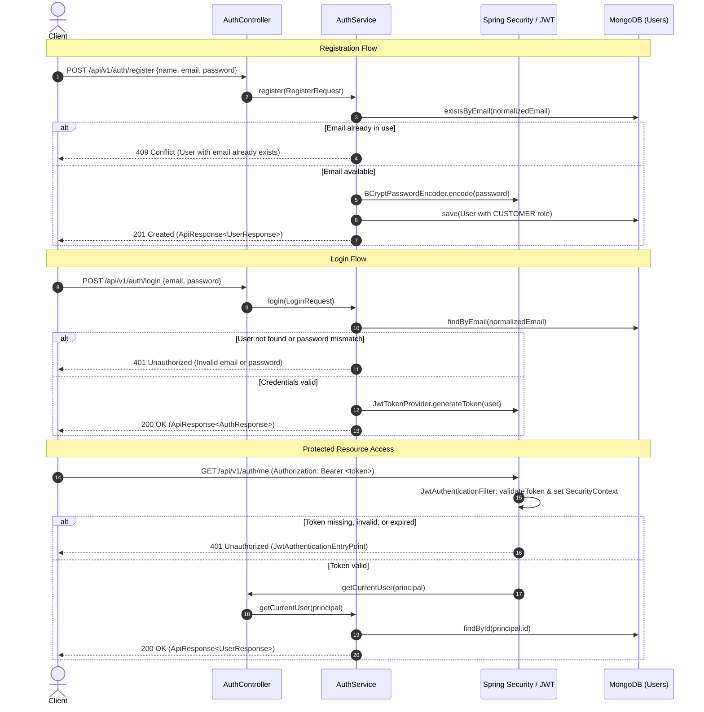

# Phase 5: User Authentication and JWT Security

## 1. Overview

Phase 5 establishes stateless user authentication, credential validation, password hashing, and role-aware JSON Web Token (JWT) services for the Scalable E-Commerce System.

The security architecture adheres to Spring Security best practices:
- **Stateless Sessions**: No HTTP session state is stored on the server (`SessionCreationPolicy.STATELESS`).
- **Cryptographic Hashing**: Sensitive credentials are never stored in plaintext. Passwords are salted and hashed using Spring Security's `BCryptPasswordEncoder`.
- **HMAC-SHA256 Tokens**: Authentication tokens are signed with a minimum 256-bit secret key using the standard JJWT library.
- **Structured Error Responses**: All security-related rejections (401 Unauthorized, 403 Forbidden, 409 Conflict) integrate with the Phase 4 standard API response envelopes.

---

## 2. Authentication Flow



---

## 3. Password Hashing with BCrypt

### Implementation
Passwords are hashed using Spring Security's `BCryptPasswordEncoder`.
- **One-way hashing**: It is computationally infeasible to invert a BCrypt hash.
- **Salt generation**: BCrypt automatically incorporates a cryptographically strong 128-bit random salt into each hash string. This protects against rainbow table attacks.
- **Key stretching**: The work factor (log rounds, default `10`) introduces controlled work factor delay, mitigating brute-force and dictionary attacks.
- **Credential hygiene**: Raw plaintext passwords are accepted only in inbound request bodies, immediately hashed, and never logged, cached, or returned in any response DTO.

---

## 4. JWT Architecture and Claims

### Token Specification
- **Algorithm**: HMAC using SHA-256 (`HS256`).
- **Signing Key**: Minimum 256-bit (32-byte) secret configured via environment variable `JWT_SECRET`.
- **Default Expiration**: 900,000 milliseconds (15 minutes), configurable via `JWT_EXPIRATION_MS`.

### Payload Claims
```json
{
  "sub": "67160911a1b2c3d4e5f6a7b8",
  "email": "jane.doe@example.com",
  "role": "CUSTOMER",
  "iat": 1729500000,
  "exp": 1729500900
}
```

| Claim | Key | Description |
|---|---|---|
| Subject | `sub` | The user's unique MongoDB database identifier (`id`). |
| Email | `email` | The user's canonical, normalized email address. |
| Role | `role` | User role for authorization decisions (e.g. `CUSTOMER`, `ADMIN`). |
| Issued At | `iat` | Epoch seconds indicating when the token was generated. |
| Expiration | `exp` | Epoch seconds marking when the token becomes invalid. |

---

## 5. Role and Authorization Policy

1. **Default Registration Role**: All self-registered users via `POST /api/v1/auth/register` receive the `CUSTOMER` role.
2. **Privilege Escalation Protection**: The registration API strictly ignores any role input from clients, preventing unauthorized escalation to privileged roles such as `ADMIN` or `SELLER`.
3. **Public Endpoints**:
   - `GET /api/health`
   - `GET /api/health/dependencies`
   - `POST /api/v1/auth/register`
   - `POST /api/v1/auth/login`
4. **Protected Endpoints**:
   - `GET /api/v1/auth/me` (requires authenticated Bearer token)
   - All future domain endpoints require valid credentials unless explicitly made public.

---

## 6. Endpoints Reference

### 6.1 Register User
- **Method**: `POST`
- **URL**: `/api/v1/auth/register`
- **Auth**: None (Public)
- **Request Body**:
  ```json
  {
    "name": "Jane Doe",
    "email": "jane.doe@example.com",
    "password": "Password123!"
  }
  ```
- **Validation Rules**:
  - `name`: Required, max 100 characters.
  - `email`: Required, valid email format.
  - `password`: Required, 8–100 characters.
- **Success Response** (`201 Created`):
  ```json
  {
    "success": true,
    "message": "User registered successfully.",
    "data": {
      "id": "67160911a1b2c3d4e5f6a7b8",
      "name": "Jane Doe",
      "email": "jane.doe@example.com",
      "role": "CUSTOMER",
      "createdAt": "2026-10-21T06:45:00.000Z"
    },
    "timestamp": "2026-10-21T06:45:00.123Z"
  }
  ```

### 6.2 Login
- **Method**: `POST`
- **URL**: `/api/v1/auth/login`
- **Auth**: None (Public)
- **Request Body**:
  ```json
  {
    "email": "jane.doe@example.com",
    "password": "Password123!"
  }
  ```
- **Success Response** (`200 OK`):
  ```json
  {
    "success": true,
    "message": "Authentication successful.",
    "data": {
      "user": {
        "id": "67160911a1b2c3d4e5f6a7b8",
        "name": "Jane Doe",
        "email": "jane.doe@example.com",
        "role": "CUSTOMER",
        "createdAt": "2026-10-21T06:45:00.000Z"
      },
      "accessToken": "eyJhbGciOiJIUzI1NiJ9...",
      "tokenType": "Bearer",
      "expiresIn": 900
    },
    "timestamp": "2026-10-21T06:45:30.456Z"
  }
  ```
- **Failure Response** (`401 Unauthorized`):
  ```json
  {
    "timestamp": "2026-10-21T06:45:31.000Z",
    "status": 401,
    "error": "Unauthorized",
    "message": "Invalid email or password.",
    "path": "/api/v1/auth/login"
  }
  ```

### 6.3 Current User Profile
- **Method**: `GET`
- **URL**: `/api/v1/auth/me`
- **Auth**: Bearer `<accessToken>`
- **Success Response** (`200 OK`):
  ```json
  {
    "success": true,
    "message": "Current user profile retrieved successfully.",
    "data": {
      "id": "67160911a1b2c3d4e5f6a7b8",
      "name": "Jane Doe",
      "email": "jane.doe@example.com",
      "role": "CUSTOMER",
      "createdAt": "2026-10-21T06:45:00.000Z"
    },
    "timestamp": "2026-10-21T06:46:00.789Z"
  }
  ```
- **Unauthenticated Failure** (`401 Unauthorized`):
  ```json
  {
    "timestamp": "2026-10-21T06:46:01.000Z",
    "status": 401,
    "error": "Unauthorized",
    "message": "Authentication required. Missing, invalid, or expired authentication token.",
    "path": "/api/v1/auth/me"
  }
  ```

---

## 7. Testing in Postman

1. Import `testing/ecommerce-api.postman_collection.json` and `testing/ecommerce-local.postman_environment.json`.
2. Execute **Register User** (`POST {{baseUrl}}/api/v1/auth/register`).
3. Execute **Login User** (`POST {{baseUrl}}/api/v1/auth/login`).
   - The test script automatically saves `accessToken` into Postman collection and environment variables.
4. Execute **Get Current User Profile (Protected)** (`GET {{baseUrl}}/api/v1/auth/me`).
   - Uses `Authorization: Bearer {{accessToken}}` to verify authentication.
5. Execute **Get Current User (Unauthenticated - 401 Expected)**.
   - Verifies the security rejection format.

